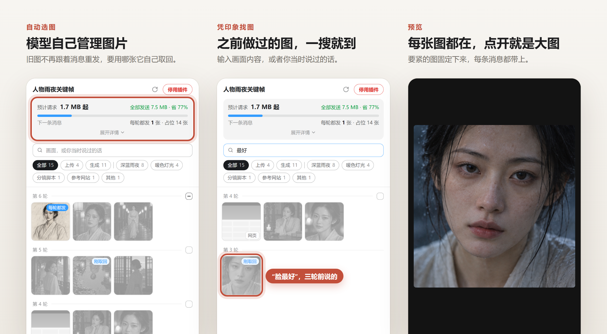
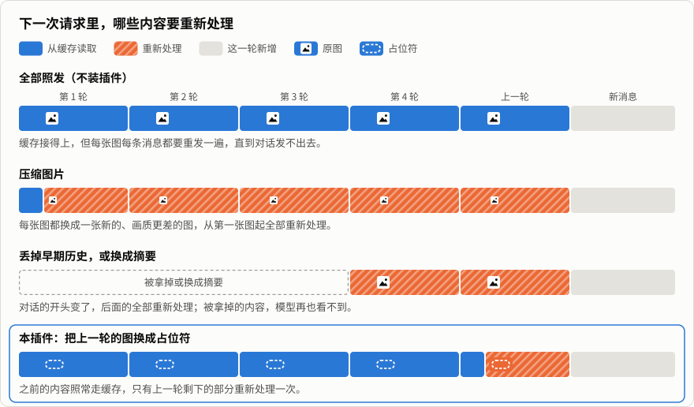
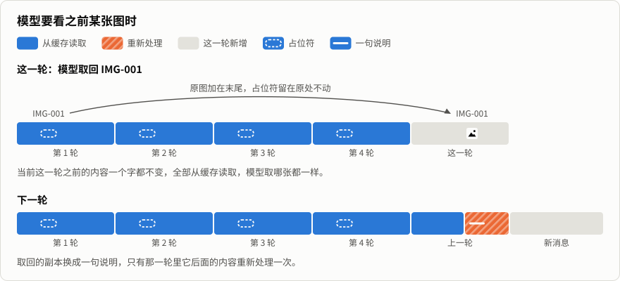

<p align="center">
  
</p>

<h1 align="center">Context Attachment Manager</h1>

<p align="center"><b>Codex、Claude Code 等 Agent 多圖對話的本地外掛。</b><br>之前的圖不再每條訊息都重發一遍。模型要看哪張，按編號取回，對話壓縮之後也一樣。</p>

<p align="center">
  <a href="https://github.com/chipfighter/context-attachment-manager/releases"></a>
  
  <a href="LICENSE"></a>
</p>

<p align="center"><a href="README.md">English</a> · <b>簡體中文</b> · <a href="README_JA.md">日本語</a> · <a href="README_KO.md">한국어</a> · <a href="README_ES.md">Español</a> · <a href="README_PT_BR.md">Português (Brasil)</a> · <a href="README_FR.md">Français</a> · <a href="README_DE.md">Deutsch</a></p>

<p align="center">
  
</p>

## 它做什麼

Agent 每發一條訊息，通常會把之前所有的圖再發一遍，圖一多，對話就越來越慢，最後可能發不出去。這個外掛給每張圖編號（`IMG-001`、`IMG-002`……），之前的圖改成發一段簡短的佔位：

- **模型要哪張取哪張**：需要再看之前的某張圖時，按編號取回原圖。
- **認得出是哪張**：模型給每張圖記一行看得見的特徵，也記下你對它的評價；這些寫在佔位裡，對話壓縮之後也還在。
- **儘量不打斷快取**：佔位符只寫一次，之後不再變，之前的對話照常從模型服務的快取（prompt cache）讀取。見[設計](#設計儘量不打斷快取)。
- **什麼都不刪**：原始圖片和對話記錄保持原樣。

預設開著，不用打開面板。常見用法：圖片和影片創作、掃描文件、電腦和瀏覽器操作。

## 安裝

把這句話發給你的 Agent，它會認出自己所在的平臺，完成對應的安裝：

```text
幫我安裝 Context Attachment Manager 外掛，按這裡的說明來：https://github.com/chipfighter/context-attachment-manager/blob/main/INSTALL.md
```

裝好後重啟 Agent（Claude 桌面版是新建一個 Code 會話）。檢視[支援的平臺](#支援的平臺)，或閱讀[安裝、更新和解除安裝說明](INSTALL.md)（英文）。

## 想自己掌控時，打開面板

<p align="center">
  
</p>

- **憑印象找圖**：搜“雨夜”或“臉最好”，按記得的特徵和評價找回來。
- **固定重要參考**：點開圖片，勾上**每輪都發**。
- **自己選擇圖片**：關掉**自動選圖**，決定下一條訊息帶哪些圖。

**Codex**：在任務的側邊面板裡開啟**上下文素材**。**Claude 桌面版的 Code 標籤頁**：有了圖，面板就會自動開啟；輸入 `/cam` 可以再開啟。

## 隱私

外掛在本機執行。原始圖片和對話記錄保留在你的電腦上，請求仍發給 Agent 原本使用的服務。

## 效果測試

在 Codex 裡，一段有九張關鍵幀的對話漲到 42.4 MB，重啟或壓縮之後發不出去；裝上外掛，同樣的請求是 0.12 MB。結果和復現步驟見 [Codex 對比評測](eval/README_CN.md)與 [Claude Code 長任務評測](eval/long-task/README_CN.md)。

## 設計：儘量不打斷快取

模型服務會快取對話的開頭：一次請求的開頭和上一次完全相同時，這部分從快取讀取，更快，也便宜得多。對話靠前的內容一變，從改動的地方往後都要重新處理。

想讓長對話變小，總要改動點什麼。這個外掛把改動放在儘量靠後的地方：

<p align="center">
  
</p>

- **佔位符只寫一次**：圖片在它出現的下一輪換成佔位符，只有那一輪剩下的內容重新處理一次。之後每次請求裡，佔位符都是同樣的文字。
- **取圖不動前面的內容**：原圖加在當前這一輪的末尾，佔位符留在原處。不管對話裡有多少張圖、模型取哪一張，當前這一輪之前的內容都照常從快取讀取。
- **拿回來的是原圖**：不是縮小的副本，也不是一段摘要。

<p align="center">
  
</p>

這不是沒有代價：有圖的一輪結束後，那一輪剩下的內容要重新處理一次，模型還要給每張新圖寫一行特徵。在面板裡改一張舊圖的設定（取消、勾回、**每輪都發**），對話在那張圖的位置變了，後面的內容也要重新處理一次。在 [Claude Code 長任務評測](eval/long-task/README_CN.md)裡，裝外掛時 87% 的輸入從快取讀取，不裝是 91%。

第一張圖的第三行，也是 Agent 自帶的壓縮和 API 側清理舊工具結果（例如 Anthropic 的 context editing）的做法：靠前的內容被拿掉，後面的重新處理。

## 支援的平臺

Codex 和 Claude Code 已實測，Codex 和 Claude 桌面版還有面板。下面其他平臺也支援，接入是照各平臺的程式碼和文件寫的，但我們還沒有實際測過。如果你在用其中某個，歡迎[告訴我們用起來怎麼樣](https://github.com/chipfighter/context-attachment-manager/issues)，能用和不能用都有幫助。

| 平臺 | 簡介 | 接入情況 |
|---|---|---|
| [Codex](https://github.com/openai/codex) | OpenAI 的程式設計智慧體，桌面版和命令列 | 自動選圖＋面板，已實測 |
| [Claude Code](https://github.com/anthropics/claude-code) | Anthropic 的程式設計智慧體，桌面版和命令列 | 自動選圖＋面板（桌面版），已實測 |
| [WorkBuddy](https://www.workbuddy.cn) | 騰訊的桌面 AI 工作助手，內建 CodeBuddy | 自動選圖，未實測 |
| [OpenCode](https://github.com/anomalyco/opencode) | 開源的終端程式設計智慧體，能接任意模型服務 | 自動選圖，未實測 |
| [Gemini CLI](https://github.com/google-gemini/gemini-cli) | Google 開源的終端智慧體 | 自動選圖，未實測 |
| [pi](https://github.com/earendil-works/pi) | 極簡、可擴充套件的終端程式設計智慧體 | 自動選圖（pi 擴充套件），未實測 |
| [DeepSeek Harness](https://github.com/deepseek-ai/deepseek-harness) | DeepSeek 的智慧體框架，一切皆外掛 | 自動選圖（dsh 外掛），未實測 |
| [Qwen Code](https://github.com/QwenLM/qwen-code) | 通義千問開源的終端智慧體 | 自動選圖，未實測 |
| [Cline](https://github.com/cline/cline) | 開源的程式設計智慧體，VS Code、JetBrains 和終端都能用 | 自動選圖，未實測 |
| [Kilo Code](https://github.com/Kilo-Org/kilocode) | 開源的程式設計智慧體，VS Code、JetBrains 和終端都能用 | 自動選圖，未實測 |
| [goose](https://github.com/aaif-goose/goose) | 開源的桌面和終端智慧體，用 MCP 擴充套件 | 自動選圖，未實測 |
| [Cherry Studio](https://github.com/CherryHQ/cherry-studio) | 開源的桌面 AI 聊天客戶端，能接多家模型 | 自動選圖，未實測 |

這些平臺的安裝步驟見 [INSTALL.md](INSTALL.md#other-agents)（英文）。想接入別的 Agent，見[接入說明](ADAPTERS.md)（英文）。

## 常見問題

### 為什麼 Codex、Claude Code 的對話圖一多就變慢？

Agent 每發一條訊息，通常會把之前所有的圖再發一遍，圖一多，對話就越來越慢，最後可能發不出去。在 Codex 裡，一段有九張關鍵幀的對話漲到 42.4 MB，重啟或壓縮之後發不出去；裝上 Context Attachment Manager，同樣的請求是 0.12 MB。

### 用了 Context Attachment Manager，提示快取（prompt cache）會失效嗎？

影響很小。佔位符只寫一次，之後不再變；取回的原圖加在當前這一輪的末尾，所以之前各輪照常從快取讀取。有圖的一輪結束後，那一輪剩下的內容要重新處理一次。在 Claude Code 長任務評測裡，裝外掛時 87% 的輸入從快取讀取，不裝是 91%。

### 它和對話壓縮、壓縮圖片有什麼不同？

對話壓縮和丟掉早期歷史會拿掉對話靠前的內容，壓縮圖片會改動這些內容。兩種做法下，幾乎整段對話都要重新處理，模型手裡只剩摘要或縮小的副本。用 Context Attachment Manager，只有上一輪剩下的部分重新處理，模型按編號取回的是原圖。

### 模型還能看到之前的圖嗎？

能。每張圖都有編號，比如 `IMG-001`，模型需要再看時按編號取回原圖，對話壓縮之後也一樣。

### 我的圖片會被刪除，或者發到別的地方嗎？

不會。外掛在本機執行，原始圖片和對話記錄保持原樣，請求仍發給 Agent 原本使用的服務。

### 支援哪些平臺？收費嗎？

Codex 和 Claude Code 已實測。WorkBuddy、OpenCode、Gemini CLI、pi、DeepSeek Harness、Qwen Code、Cline、Kilo Code、goose、Cherry Studio 也支援，接入是照各平臺的程式碼和文件寫的，還沒有實際測過。專案開源，使用 MIT 許可證，不收費。

### 怎麼安裝 Context Attachment Manager？要用終端嗎？

不用。把上面[安裝](#安裝)一節的那句話發給你的 Agent，它會認出自己所在的平臺、自己完成安裝，你只需要在裝好後重啟 Agent（Claude 桌面版是新建一個 Code 會話）。在 Codex 裡也可以到外掛頁點幾下裝上。想自己動手的話，Codex 是一條命令，Claude 桌面版是兩條 `claude` 命令，見 [INSTALL.md](INSTALL.md)（英文）。

<p align="center"><sub><a href="CHANGELOG.md">更新記錄</a> · <a href="CONTRIBUTING.md">參與開發</a> · <a href="LICENSE">MIT 許可證</a></sub></p>
